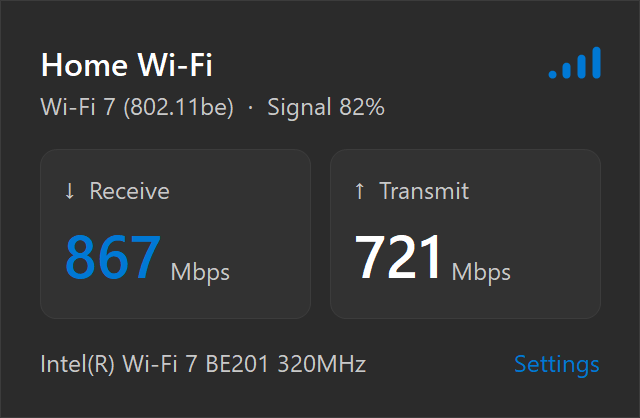

# Notify

**Your Wi-Fi link speed, live in the Windows system tray.**

Notify puts the current connection speed (for example `867`) right on its tray icon, so you can see at a glance whether you're on a fast link or have dropped to a slow band. Click the icon for a Windows 11-style flyout with the details.



## What it shows

| Where | What |
|---|---|
| **Tray icon** | The receive (or transmit) link rate in Mbps, e.g. `867`, or `1.2G` above 1000 Mbps. A dimmed `–` means not connected. The number is white on a dark taskbar and black on a light one (or a colour you pick). |
| **Hover** | Network name, receive and transmit rates, signal strength. |
| **Left-click** | Flyout: network name, Wi-Fi generation (Wi-Fi 5/6/7), signal bars, receive and transmit speeds, adapter, and a Settings link. Closes when you click away or press Esc. |
| **Right-click** | Menu: current network, Settings…, Start with Windows, About, Exit. |

The speed is the **link rate** Windows has negotiated with your router, the same figure as *Settings → Network → Wi-Fi → Properties*. It's the ceiling for your Wi-Fi hop, not an internet speed test.

## Settings


- **Adapter**: *Automatic* follows whichever Wi-Fi adapter is connected (and falls back to the fastest wired adapter if there's no Wi-Fi). Or pick a specific adapter.
- **Refresh every**: 1 to 3600 seconds (default 2).
- **Icon shows**: receive (download) or transmit (upload) link rate.
- **Number colour**: Automatic (matches your taskbar) or any named colour.
- **Start with Windows**: adds Notify to your sign-in apps (per user, no admin rights needed).

Settings are saved in `%APPDATA%\Notify\settings.json`.

### Network name and signal strength need location access

Since Windows 11 24H2, Windows only gives desktop apps the Wi-Fi network name (SSID) and signal strength if **location access** is allowed, because nearby network names can reveal where you are. Without it, Notify still shows your link speed (from the adapter itself); the flyout just says *Wi-Fi connected* and offers a link to the setting.

To allow it: **Settings → Privacy & security → Location**, turn on **Location services** and **Let desktop apps access your location**.

## Requirements

- Windows 10 or 11 (the rounded, dark-aware look needs Windows 11).
- [.NET 10 Desktop Runtime](https://dotnet.microsoft.com/download/dotnet/10.0) (x64), unless you use a self-contained build (below).

## Build and run

```powershell
dotnet build Notify/Notify.csproj -c Release
dotnet Notify/bin/Release/net10.0-windows/Notify.dll
```

`Notify.exe` sits next to the DLL and can be started directly. On managed PCs where app control blocks unsigned executables, run it through `dotnet Notify.dll` as above.

To make a single, self-contained `Notify.exe` that needs no .NET install:

```powershell
dotnet publish Notify/Notify.csproj -c Release -r win-x64 --self-contained -p:PublishSingleFile=true -o publish
```

Only one copy runs per user; starting it again does nothing.

## How it works

| File | Purpose |
|---|---|
| `Program.cs` | Single-instance start-up, DPI awareness, light/dark mode. |
| `TrayContext.cs` | Tray icon, menu, refresh timer, flyout and settings windows. |
| `NativeWifi.cs` | Reads the current connection from the Windows Native Wi-Fi API (`wlanapi.dll`): SSID, signal, PHY type and receive/transmit rates. Falls back to the adapter's link speed when Windows withholds details. |
| `NetworkReader.cs` | Picks the adapter (automatic or chosen), formats speeds, lists real adapters (hides unplugged and virtual filter entries). |
| `IconRenderer.cs` | Draws the number at the tray's real size for the current display scaling (16 px at 100%, 32 px at 200%). |
| `FlyoutForm.cs`, `SettingsForm.cs`, `Theme.cs` | The Windows 11-style UI: accent colour, dark title bar, rounded corners. |
| `AppSettings.cs` | JSON settings and the *Start with Windows* registry entry. |

## Version 2.0 (2026): what changed from the 2017 version

- Rebuilt for **.NET 10** (from .NET Framework 4.5); no WMI dependency.
- Speed now comes from the **Wi-Fi API**, with separate receive and transmit rates, instead of WMI's `Win32_NetworkAdapter.Speed`. This also fixes the old "shows 0, try the Hyper-V adapter" problem: *Automatic* finds the connected Wi-Fi adapter itself.
- **Fixed:** the icon froze for good after you right-clicked it (opening the menu stopped the timer and nothing restarted it).
- **Fixed:** a GDI/icon-handle leak on every refresh (a new bitmap, brush and icon handle each tick, never freed).
- **Fixed:** a crash when the refresh box was left empty, and adapter names containing an apostrophe breaking the WMI query.
- Crisp icon at any display scaling; number colour follows your taskbar's light/dark theme automatically.
- New flyout, redesigned settings window, Start with Windows, single instance, first-run tip.

## Licence

GNU General Public License v3 or later; see [Notify/License.txt](Notify/License.txt).

Copyright (C) 2017-2026 Steven Connelly.
